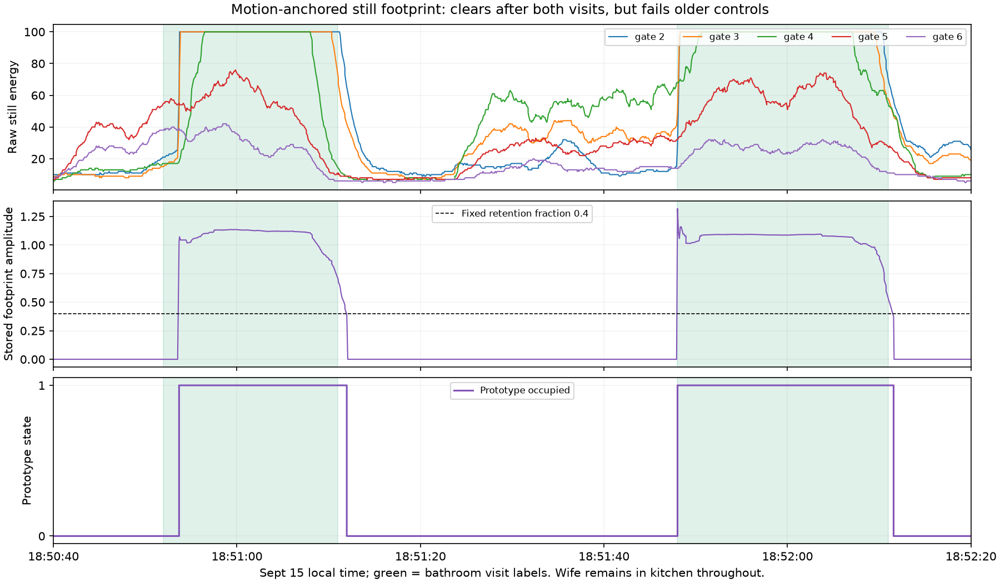

# 21. Follow a motion-anchored still footprint through departure

## Hypothesis

When one person enters the bathroom while someone remains in the kitchen,
the bathroom visit may add a distinguishable pattern across the still-energy
gates. Motion can identify that pattern initially; its disappearance, rather
than a generic departure motion event, could clear bathroom occupancy.

**Result: this prototype follows both visits in the simultaneous Sept 15
capture and clears afterward, but fails older controls. It is not a reliable
wall discriminator or an imperceptible occupancy solution.**

## Causal prototype

Only bathroom sensor frames enter the calculation. Labels are used after replay
for scoring and shading the plot. No supervised training, label-selected
reference periods, room-distance boundary, or kitchen-sensor input.

For gates 2–8 (the gates with both channels):

1. Maintain a background still vector `B` using an exponential average while
   no footprint is active. Start from the recording's first still frame.
2. Compute positive excess `r = max(S - B, 0)`.
3. When peak motion exceeds a fixed bar, form a candidate footprint
   `h = r * M / max(M)`. This emphasizes gates participating in the motion.
   Store it, freezing the background. Replace it only with a candidate of
   greater squared magnitude during subsequent strong motion.
4. Each frame compute `a = dot(r,h) / dot(h,h)`. This is the least-squares
   amplitude of the stored pattern in the current excess. Retain presence
   while `a >= fraction`; otherwise discard the footprint and resume background
   averaging. **No departure motion event is required.**

Candidates with squared magnitude below 1 are ignored. Gaps above .55 s reset
both background and footprint. No confirmation, dwell, or output smoothing.
The background time constant is not a waiting period before decisions.

A predefined diagnostic sensitivity grid uses background time constants
5/15/30 s, motion bars 20/40, and retention fractions .2/.4/.6. These are
engineering assumptions, not physical constants or a calibrated wall model.
The example below is the middle time constant, motion 40, fraction .4;
no best-performing setting was selected. Replay processes the full recordings,
including unlabeled prefixes, without label-boundary resets.

## Simultaneous kitchen/bathroom capture

`labeled-walk-0915.db`; wife labeled in kitchen throughout this evaluation.

| Visit | Positive bathroom frames | First positive after entry label | First negative after exit label |
|---|---:|---:|---:|
| First | 173/190 | 1.69 s | .97 s |
| Second | 231/231 | .016 s | .57 s |

Once detected, neither visit has a false drop before departure. Across all
571 kitchen-only frames, 15 remain positive, all in the two exit tails. The
prototype then stays clear through the remainder of those labeled spans.
This demonstrates that continued kitchen presence need not force a continued
bathroom hold in this recording.

These label-relative timings are **not independently measured physical latency**;
the transition labels were derived using radar traces. Even taking them at face
value, first entry does not meet the user's imperceptible-response requirement.

## Counterexamples and sensitivity

- Solo Sept 15 loop: 775/779 bathroom frames positive, but first clear is
  6.86 s after the exit label. Kitchen-only frames are 7.74% positive.
- Older known bathroom-empty morning: 14.14% of kitchen frames falsely held.
  Rare strong kitchen motion can seed a footprint, then ordinary still bleed
  sustains it. This amplifies the six-frame motion-only false-positive problem
  observed in experiment 20.
- Sept 9 older bathroom sessions: only 47.49% of bathroom frames positive;
  the longer toilet session has a continuous missing-evidence interval of
  92.57 s. A quiet occupant does not retain a fixed amplitude/shape indefinitely.
- Separate Sept 11 bathroom visit: only 49.63% positive, with an 81.03 s missing
  interval. Thus the problem is not confined to uncertain kitchen labels.

Across all 18 settings, morning kitchen false-positive frame fractions remain
13.2–19.7%. Raising the retention fraction to .6 shortens the simultaneous
walk's exit tails, but does not fix these older failures. No tested setting
solves the complete problem. Older loader spans are sometimes conservatively
trimmed; their ends are not precise physical departure timestamps.

## Interpretation

Motion can select a useful still-energy footprint in the target capture.
That is more specific than holding whenever *any* still energy remains, and
it does not release merely because someone moves out. However, this footprint
is not an identified person or wall signature. People at the same ranges can
contribute to the same gates. The background can change; quiet bathroom
movement can change the footprint; and kitchen motion can initialize one.

The reported energies are processed and often clip at 100. Subtracting them
is a diagnostic construction, **not a demonstrated additive separation of
physical radar returns**. Further work must distinguish those cases rather
than tune exclusively against these two successful visits.

## Reproduction and verification

- `.venv/bin/python docs/research/experiments/21-component-retention/analyze.py`
- `plot.py` requires NumPy and Matplotlib.
- `results.json`: all 18 settings, per fixture and visit.
- `results.txt`: fixed example summary.
- Causality assertion verifies that replaying a recording prefix gives exactly
  the same state, score, and residual as that prefix of the full replay.
- Plot visually inspected against the recorded raw signals and labels.

No production integration changes.
